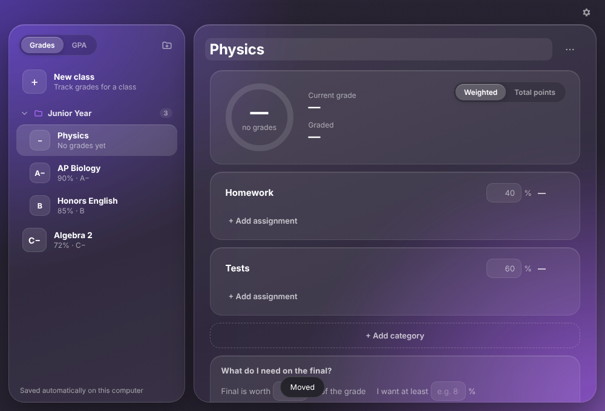
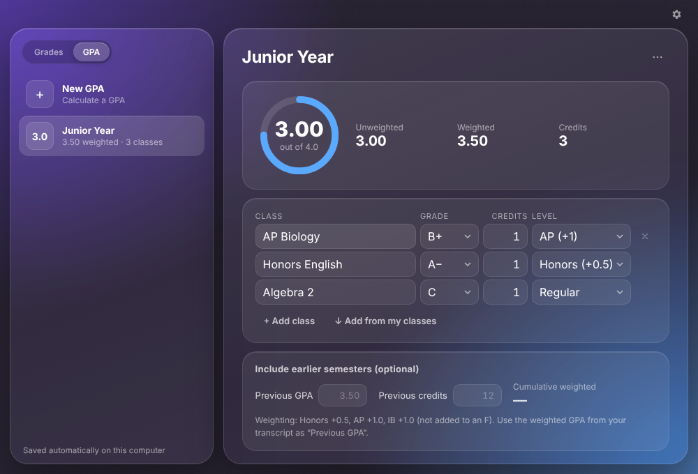

<p align="center"></p>

<h1 align="center">Gradient</h1>
<p align="center">A tiny grade &amp; GPA calculator with a liquid glass look.<br>
Windows · macOS · Linux — no account, no ads, your grades never leave your computer.</p>

<p align="center"></p>

## Features

**Grades**
- Categories with weights (Homework 30%, Tests 50%…) or simple total-points mode
- Current percentage and letter grade, updated as you type
- **“What do I need on the final?”** — shows the score you need for an A, B, C, or any target you pick

**GPA**
- Unweighted and weighted GPA
- **Honors +0.5 · AP +1.0 · IB +1.0**
- Credits per class (half-credit classes work too)
- Cumulative GPA with your previous semesters
- **Add from my classes** pulls in every class from the Grades tab with its current letter

**Organize**
- Save as many classes and GPAs as you want — changes save automatically
- **Folders** (like “Freshman Year” or “Semester 1”) in both tabs; move items with the ⋯ menu
- Build a GPA from one folder of classes in one click

**Your data**
- **Export backup** saves everything to a file in your Downloads folder
- **Import backup** on another computer — add to what’s there, or replace it
- **Erase all data** (asks you twice)
- Updating the app never deletes your data

**Looks**
- 7 color themes · Glass or Minimal style · color can follow your grade
- Optional A+ = 4.3

<p align="center"></p>

## Download

Get the latest version from the [**Releases**](../../releases) page:

| Your computer | File |
|---|---|
| Windows | `Gradient_x.x.x_x64-setup.exe` |
| Mac with Apple chip (M1 or newer) | `Gradient_x.x.x_aarch64.dmg` |
| Intel Mac | `Gradient_x.x.x_x64.dmg` |
| Linux | `.AppImage` / `.deb` / `.rpm` |

**First launch warnings:** the app isn't code-signed yet.
- **Windows:** “Windows protected your PC” → **More info → Run anyway**. Some antivirus apps may also flag new unsigned apps; you can restore and allow it.
- **Mac:** **System Settings → Privacy & Security → Open Anyway**.

## Grading scale

| Letter | A+ | A | A− | B+ | B | B− | C+ | C | C− | D+ | D | D− | F |
|---|---|---|---|---|---|---|---|---|---|---|---|---|---|
| Minimum % | 97 | 93 | 90 | 87 | 83 | 80 | 77 | 73 | 70 | 67 | 63 | 60 | 0 |
| GPA points | 4.0* | 4.0 | 3.7 | 3.3 | 3.0 | 2.7 | 2.3 | 2.0 | 1.7 | 1.3 | 1.0 | 0.7 | 0 |

\* 4.3 if you turn it on in Settings. Weighted bonuses are not added to an F.

## Build it yourself

You need [Node.js](https://nodejs.org) and [Rust](https://rustup.rs).

```bash
npm install
npm run dev      # run it
npm run build    # make an installer
```

The whole app is one file: `src/index.html`. You can also just open it in a browser.

## Releasing (for maintainers)

1. Change `version` in `src-tauri/tauri.conf.json` (and `package.json`).
2. Run **Actions → release → Run workflow** (or push a tag like `v0.2.0`).
3. A **draft release** appears with installers for every platform — check it, then **Publish**.

If the action fails with “Resource not accessible by integration”: **Settings → Actions → General → Workflow permissions → Read and write**.

## License

MIT
